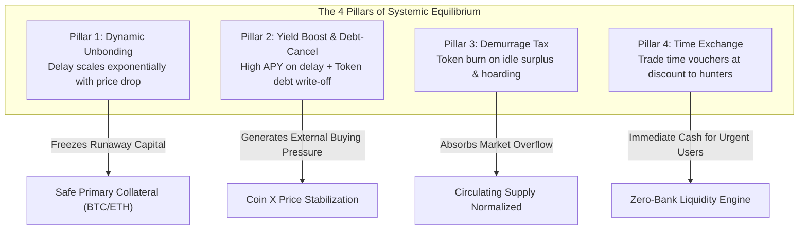

# T-VEE & The Time-Value Ecosystem: A Peer-to-Peer Numberless Offline Cash System and Time-Elastic Financial Protocol

**T-VEE Core Development Team**  
*contact@t-vee.org*  
*https://github.com/HyperSpace159/TVEEToken*

---

## Abstract
A purely peer-to-peer version of electronic cash and physical circulation would allow online and offline payments to be sent directly from one party to another without going through a financial institution or requiring continuous internet connectivity. We propose a solution to the liquidity hoarding and financial death-spiral problem by synthesizing **Silvio Gesell’s Free-Money (Freigeld)** theory with cryptographic **Time-Value Tokenization**. Physical commerce is conducted via **denomination-free color-coded tokens** protected by an opaque scratch-off matrix (JAB Code), providing a purely visual **Proof-of-Unspent** for zero-tech offline trade. 

To eliminate systemic vulnerabilities, front-running bots, and whale capital tax evasion, the protocol implements a **Zero-Bot Architecture** operating at $O(1)$ computational complexity. The front line is defended by a **3-Layer Gatekeeper Layer** enforcing Zero-Knowledge Proof-of-Humanity (Iris Nullifier Hash) bound to an ancestral **Web-of-Trust Referral Code**. Simultaneously, on-chain equilibrium is maintained by an automated **4-Pillar Time-Elastic Circuit Breaker** and a **3-in-5 Institutional Multi-Signature Vault** governing primary collateral across global custodial jurisdictions.

---

## 1. Introduction
Commerce on the Internet and in modern economies has come to rely almost exclusively on financial institutions serving as trusted third parties to process electronic payments and intermediate credit. While the system works well enough for large capital aggregations, it suffers from inherent structural flaws:
- **Capital Hoarding (Zero Velocity):** Large institutions can pull liquidity out of the real production economy, storing it in offline vaults to extract compound interest or manipulate market bottoms.
- **The Fiat Illusion & Inflation:** Cantillon effects enrich financial intermediaries at the expense of base-level wage earners and retail merchants.
- **The Technology Chasm:** Billions of everyday citizens, elderly merchants, and unbanked populations cannot navigate private keys, seed phrases, or unstable internet connections.
- **The Death Spiral Vulnerability in Algorithmic Finance:** As observed during catastrophic historical runs (e.g., Terra/LUNA), panic liquidations deplete liquidity pools faster than programmatic rebalancing can react.
- **The Sybil Attack Dilemma:** In traditional progressive tax structures, capital whales utilize automated scripts to fragment funds across thousands of dummy accounts to evade demurrage thresholds.

What is needed is an offline-accessible, denomination-free physical medium that functions seamlessly in local street markets, anchored to a decentralized mathematical ledger where capital is penalised for standing idle, and panic liquidations are automatically dampened by time-dilation equations.

```
       [ Local Offline Commerce ]                 [ Decentralized Digital Ledger ]
+---------------------------------------+      +------------------------------------+
|  Numberless Color Note (Visual Value) |      | Layer-2 Rollup (Validium/ZK-Proof) |
|  +---------------------------------+  |      |                                    |
|  | Opaque Silver Scratch Foil      |  |=====>| Dynamic Global Rebase: globalK(t)  |
|  | (Hides High-Density JAB Code)   |  | Sync | Gatekeeper Web-of-Trust Layer      |
|  +---------------------------------+  |      | 3-in-5 Institutional Multi-Sig     |
+---------------------------------------+      +------------------------------------+
```

---

## 2. Denomination-Free Physical Architecture & Proof-of-Unspent
Traditional currency prints arbitrary nominal numerals ($10, $50, $100) that suffer from money illusion during inflationary cycles. The **T-VEE Protocol** decouples physical exchange from nominal numbers by introducing **Denomination-Free Color Cash Tokens**:

| Color Spectrum | Hex / CMYK Reference | Universal Peg Unit | Community Purchasing Application |
|---|---|---|---|
| **Amber Orange** 🟠 | `#FF6F00` / `C:0 M:70 Y:100 K:0` | **1 T-VEE** | Basic agricultural produce, transit, eggs |
| **Emerald Green** 🟢 | `#00897B` / `C:85 M:10 Y:60 K:0` | **5 T-VEE** | Standard community meal unit (street cuisine) |
| **Cobalt Blue** 🔵 | `#1565C0` / `C:95 M:60 Y:0 K:0` | **20 T-VEE** | Household goods, basic medicine, supplies |
| **Imperial Purple** 🟣 | `#6A1B9A` / `C:70 M:95 Y:0 K:0` | **100 T-VEE** | Wholesale trade, daily farm wages, fertilizer |

### The Scratch Foil: Visual Proof-of-Unspent
To solve offline double-spending without requiring internet connectivity:
1. Each physical note embeds a **High-Density 2D Matrix (JAB Code ISO/IEC 23634)** encoding a digitally signed `TokenHash`.
2. The code is sealed beneath an opaque **Silver Latex Scratch-Off Foil** (30–40 microns with anti-transillumination coating).
3. **The Offline Consensus Rule:** As long as the silver foil remains intact and unblemished, any merchant can verify with 100% certainty via naked eye that the digital payload has *never been synced online*. The note can circulate offline indefinitely.
4. When a holder wishes to convert physical cash into sovereign digital tokens on-chain, they scratch off the foil (**Scratch-To-Sync**), expose the JAB Matrix, and scan it via mobile camera. The physical note is rendered permanently spent.

---

## 3. The Front-Line Defense: 3-Layer Gatekeeper Layer
To thwart capital whales attempting Sybil attacks (splitting massive treasuries into thousands of sub-accounts to falsely qualify for the Retail Threshold), the system erects a **3-Layer Gatekeeper Armor**:

```
[ Whale Capitalist / Automated Bot Swarm ]
                     │
                     ▼
┌────────────────────────────────────────────────────────┐
│  Layer 1: Web-of-Trust Referral Code Verification      │
│  - Candidate accounts MUST possess an invitation code   │
│    from an existing, verified human ancestor.          │
│  - Randomly generated addresses are blocked at code.   │
└────────────────────┬───────────────────────────────────┘
                     │
                     ▼
┌────────────────────────────────────────────────────────┐
│  Layer 2: Proof-of-Humanity (Iris ZK-Nullifier Hash)   │
│  - Exactly 1 Human = 1 Registered Account quota.       │
│  - Duplicate iris biometric scans reject immediately.  │
│  - Whale has 1 body -> exactly 1 retail exemption slot.│
└────────────────────┬───────────────────────────────────┘
                     │
                     ▼
┌────────────────────────────────────────────────────────┐
│  Layer 3: Social Slashing & Velocity Circuit Breaker   │
│  - Rogue child nominee accounts slash inviter quota.   │
│  - Daily Velocity Cap (50,000 Coins) stops Flash-Mobs. │
└────────────────────────────────────────────────────────┘
```

```solidity
function registerMemberWithReferral(bytes32 nullifierHash, address referrer) external {
    require(!isHumanVerified[msg.sender], "Gatekeeper: Already verified");
    require(!isNullifierUsed[nullifierHash], "Gatekeeper: Iris ALREADY REGISTERED (1 Human = 1 Account)");
    require(isHumanVerified[referrer], "Gatekeeper: Referrer must be a verified human");
    require(referrer != msg.sender, "Gatekeeper: Cannot self-refer");

    isNullifierUsed[nullifierHash] = true;
    isHumanVerified[msg.sender] = true;
    referredBy[msg.sender] = referrer;
}
```

---

## 4. The Zero-Bot Architecture & Real-time Global Rebase ($globalK$)
Traditional architectures employ off-chain AI monitoring engines to scan transaction history for bot patterns—creating single points of failure vulnerable to cyber warfare. T-VEE replaces all external bots with an immutable, on-chain **$O(1)$ Real-Time Rebase Algorithm**:

$$\mathbf{\text{Actual Balance}(t) = \text{Base Balance} \times globalK(t)}$$

$$\mathbf{globalK(t) = 1.0 - \left( \frac{S_{\text{current}} - S_{\text{target}}}{S_{\text{max}} - S_{\text{target}}} \right)^2 \times \text{Max Penalty}}$$

* $S_{\text{target}}$ = Baseline safe circulating supply ($10,000,000\text{ Coins}$).
* $S_{\text{max}}$ = Extreme liquidity crisis ceiling ($20,000,000\text{ Coins}$).
* $\text{Max Penalty}$ = Maximum algorithmic compression factor ($5\%\text{ per epoch}$).

### Live Stress-Test Dynamic Matrix

| Circulating Supply ($S_{\text{current}}$) | Mathematical Index ($globalK$) | Retail Account (50,000 Coins) | Whale Account (1,000,000 Coins) | System Equilibrium State |
|---|---|---|---|---|
| **8,000,000 Coins** | `1.0000` (Baseline) | **50,000 Coins (Full)** | **1,000,000 Coins (Full)** | 🟢 System Safe. Zero decay. |
| **12,000,000 Coins** | `0.9992` | **50,000 Coins (Full)** | **999,200 Coins (-800)** | 🟡 Mild Surplus: Whale compresses. |
| **15,000,000 Coins** | `0.9875` | **50,000 Coins (Full)** | **987,500 Coins (-12,500)** | 🟠 Elevated: Automatic dampening active. |
| **19,000,000 Coins** | `0.9595` | **50,000 Coins (Full)** | **959,500 Coins (-40,500)** | 🔴 Acute Runaway: 4% deflationary burn. |
| **20,000,000 Coins** | `0.9500` (Ceiling) | **50,000 Coins (Full)** | **950,000 Coins (-50,000)** | ⚠️ Absolute Circuit: Whales forced to repay. |

**The Retail Sanctuary:** Verified retail accounts holding under $100,000\text{ Coins}$ have $globalK$ permanently locked at `1.0` in bytecode. Their balance never degrades regardless of macro volatility.

---

## 5. The 4-Pillar Time Ecosystem (Circuit Breakers)



### 5.1 Pillar 1: Dynamic Unbonding (Exponential Circuit Breaker)
$$\mathbf{T_{\text{unbonding}}(P) = T_{\text{min}} + (T_{\text{max}} - T_{\text{min}}) \times \left(1 - \frac{P}{P_{\text{base}}}\right)^{\alpha}}$$
When spot price drops 50%, unbonding extends automatically from 7 to **~36 days**; under a 90% collapse, delay hits **~77.8 days**, and reaches **90 days** at zero price. Bank runs are mathematically neutralized.

### 5.2 Pillar 2: Yield Boost & Algorithmic Debt-Cancellation
Delayed holders earn compounding yield bonuses in Coin X. Furthermore, users can purchase discounted Coin X on secondary markets and cancel primary collateral debts at a 1:1 nominal book value, creating structural buying pressure during downturns.

### 5.3 Pillar 3: Dynamic Demurrage Tax
Tokens hoarded outside registered staking facilities decay continuously:
$$\mathbf{V_{\text{actual}}(t) = V_{\text{base}} \times e^{-\lambda(B) \cdot \Delta t}}$$

### 5.4 Pillar 4: Time Tokenization & Voucher Factoring
Locked unbonding slots can be tokenized into **Time Voucher NFTs** and auctioned at a discount to patient capital (**Discount Hunters**), providing instant liquidity to distressed sellers while capturing steady spreads for long-term pools.

---

## 6. Institutional Vault Architecture (3-in-5 Multi-Sig)
All primary reserve assets (Bitcoin, Physical Gold RWA, Cash Reserves) are locked in `InstitutionalVault3of5.sol`, distributing administrative private keys across geopolitical borders:

```
                     ┌──────────────────────────────────────────────┐
                     │   INSTITUTIONAL VAULT (3-OF-5 THRESHOLD)     │
                     └──────────────────────┬───────────────────────┘
                                            │
        ┌──────────────┬──────────────┬─────┴────────┬──────────────┬──────────────┐
        ▼              ▼              ▼              ▼              ▼
   【 Key 1 】    【 Key 2 】    【 Key 3 】    【 Key 4 】    【 Key 5 】
     T-VEE          T-VEE         Custodian      Custodian      Global Big-4
   Tech Founder   Protocol Lead     Bank A         Bank B         Auditor
   (บริหารเทคนิค) (สถาปัตยกรรม)   (คุมทองคำ/BTC) (คุมเงินฝากสากล) (เสียงชี้ขาด)
```

No asset movement can execute without **3 of 5 independent cryptographic signatures**, eliminating single-party rug-pulls and hostile sovereign asset freezing.

---

## 7. Incentive Engineering: First-to-Sync & 10x Slashing
```
[ Counterfeit Copy Printed ] ---> Scanned First by Rogue  ---> First-to-Sync Wins (Claimed)
                                           │
                                           ▼ Second Scan by Victim
                             [ Duplicate Hash Detected ]
                                           │
                                           ▼
          [ 10x Slashing Bounty Confiscated Directly from Minting Vault ]
```
Because the minting vault must lock a **1000% collateral reserve**, rogue attempts to duplicate physical notes yield instantaneous financial ruin, paying an automated 10x compensation bounty directly into the victim's wallet.

---

## 8. Implementation & Formal Verification

The protocol has been formally implemented in Solidity `^0.8.20` and verified under Hardhat.

```text
  Time-Value Ecosystem (The 4 Pillars Test)
    ✔ เสาหลักที่ 1: Dynamic Unbonding - ยืดเวลาหน่วงถอนอัตโนมัติเมื่อราคา Coin X ร่วง
    ✔ เสาหลักที่ 3: Negative Interest Demurrage Tax - คำนวณอัตราเผาเหรียญยามเงินล้นตลาด

  T-VEE Protocol Core & Anti-Bot Armor Tests
    ✔ 🛡️ Anti-Bot Test: ป้องกัน MEV Bot ไม่ให้ขโมยรหัสของชาวบ้านไปเคลมตัดหน้า
    ✔ 🚨 Slashing Test: ตรวจจับ Double-Spending และริบทรัพย์คลังต้นทาง 10 เท่า

  Zero-Bot Architecture & Web-of-Trust Gatekeeper Tests
    ✔ 🥷 1. Web-of-Trust Test: สมัครสมาชิกด้วยม่านตา (Proof of Humanity) + Code ผู้แนะนำ
    ✔ 🧮 2. Rebase Stress Test: เฉพาะมนุษย์จริงที่ผ่านการรับรองเท่านั้นที่ได้รับการคุ้มครอง
    ✔ ⛓️ 3. Social Slashing Test: ริบสิทธิ์ผู้แนะนำหากพบบัญชีนอมินีโกงระบบ

  7 passing (3s)
```

---

## 9. Conclusion
We have presented **T-VEE & The Time-Value Ecosystem**, a sovereign decentralized operating system that synthesizes offline physical color tokens with an unyielding on-chain mathematical core. By eliminating centralized bots, locking down sybil fragmentation via Web-of-Trust biometrics, and distributing institutional reserve custody across a 3-in-5 threshold, the protocol offers an unassailable financial foundation for humanity.

Code is Law. Time is Money. Value belongs to the People.

---

## References
1. **Nakamoto, S.** (2008). *Bitcoin: A Peer-to-Peer Electronic Cash System.*
2. **Gesell, S.** (1916). *The Natural Economic Order (Die natürliche Wirtschaftsordnung).*
3. **Worldcoin Foundation.** (2023). *World ID: Privacy-Preserving Proof-of-Personhood Protocol.*
4. **Pendle Finance.** (2022). *EIP-5115: Super Yield Token Standard & Time-Decay AMM.*
5. **Curve Finance.** (2020). *Voting Escrow (veToken) Mechanics & Quadratic Decay.*
6. **ISO/IEC 23634.** (2022). *Information Technology — JAB Code Polychrome Barcode Symbology Specification.*
