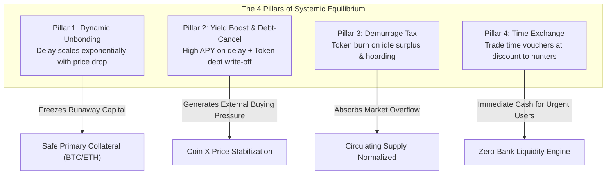

# T-VEE & The Time-Value Ecosystem: A Peer-to-Peer Numberless Offline Cash System and Time-Elastic Financial Protocol

**T-VEE Core Development Team**  
*contact@t-vee.org*  
*https://github.com/HyperSpace159/TVEEToken*

---

## Abstract
A purely peer-to-peer version of electronic cash and physical circulation would allow online and offline payments to be sent directly from one party to another without going through a financial institution or requiring continuous internet connectivity. We propose a solution to the liquidity hoarding and financial death-spiral problem by synthesizing **Silvio Gesell’s Free-Money (Freigeld)** theory with cryptographic **Time-Value Tokenization**. Physical commerce is conducted via **denomination-free color-coded tokens** protected by an opaque scratch-off matrix (JAB Code), providing a purely visual **Proof-of-Unspent** for zero-tech offline trade. 

To prevent run-on-the-bank collapses and speculative capital stagnation, the underlying Layer-2 decentralized protocol implements an automated **4-Pillar Time-Elastic Circuit Breaker**: 
1. **Dynamic Unbonding Period:** exponentially delays withdrawals during panic dumps to freeze collateral runaways;
2. **Yield Boost & Debt-Cancellation:** converts locked durations into elevated yields and algorithmic debt write-offs to induce buying pressure;
3. **Dynamic Demurrage Tax:** burns idle token surpluses when market velocity drops or circulating supply overflows;
4. **Time Tokenization & Secondary Exchange:** tokenizes waiting periods into discounted time vouchers, ensuring instant liquidity through decentralized discount hunters.

The network is secured by a crowd-enforced **First-to-Sync Wins** rule combined with an algorithmic **10x Slashing Bounty**, rendering physical counterfeiting economically catastrophic.

---

## 1. Introduction
Commerce on the Internet and in modern economies has come to rely almost exclusively on financial institutions serving as trusted third parties to process electronic payments and intermediate credit. While the system works well enough for large capital aggregations, it suffers from inherent structural flaws:
- **Capital Hoarding (Zero Velocity):** Large institutions can pull liquidity out of the real production economy, storing it in offline vaults to extract compound interest or manipulate market bottoms.
- **The Fiat Illusion & Inflation:** Cantillon effects enrich financial intermediaries at the expense of base-level wage earners and retail merchants.
- **The Technology Chasm:** Billions of everyday citizens, elderly merchants, and unbanked populations cannot navigate private keys, seed phrases, or unstable internet connections.
- **The Death Spiral Vulnerability in Algorithmic Finance:** As observed during catastrophic historical runs (e.g., Terra/LUNA), panic liquidations deplete liquidity pools faster than programmatic rebalancing can react.

What is needed is an offline-accessible, denomination-free physical medium that functions seamlessly in local street markets, anchored to a decentralized mathematical ledger where capital is penalised for standing idle, and panic liquidations are automatically dampened by time-dilation equations.

```
       [ Local Offline Commerce ]                 [ Decentralized Digital Ledger ]
+---------------------------------------+      +------------------------------------+
|  Numberless Color Note (Visual Value) |      | Layer-2 Rollup (Validium/ZK-Proof) |
|  +---------------------------------+  |      |                                    |
|  | Opaque Silver Scratch Foil      |  |=====>| Dynamic Demurrage Tax: e^(-λ·Δt)   |
|  | (Hides High-Density JAB Code)   |  | Sync | Dynamic Unbonding Circuit Breaker  |
|  +---------------------------------+  |      | Time-Voucher Factoring Marketplace |
+---------------------------------------+      +------------------------------------+
```

---

## 2. Denomination-Free Physical Architecture & Proof-of-Unspent
Traditional currency prints arbitrary nominal numerals ($10, $50, $100) that suffer from money illusion during inflationary cycles. The **T-VEE Protocol** decouples physical exchange from nominal numbers by introducing **Denomination-Free Color Cash Tokens**:

| Color Spectrum | Hex / CMYK Reference | Universal Peg Unit | Community Purchasing Application |
|---|---|---|---|
| **Amber Orange** 🟠 | `#FF6F00` / `C:0 M:70 Y:100 K:0` | **1 T-VEE** | Basic agricultural produce, transit, eggs |
| **Emerald Green** 🟢 | `#00897B` / `C:85 M:10 Y:60 K:0` | **5 T-VEE** | Standard community meal unit (street cuisine) |
| **Cobalt Blue** 🔵 | `#1565C0` / `C:95 M:60 Y:0 K:0` | **20 T-VEE** | Household goods, basic medicine, supplies |
| **Imperial Purple** 🟣 | `#6A1B9A` / `C:70 M:95 Y:0 K:0` | **100 T-VEE** | Wholesale trade, daily farm wages, fertilizer |

### The Scratch Foil: Visual Proof-of-Unspent
To solve offline double-spending without requiring internet connectivity:
1. Each physical note embeds a **High-Density 2D Matrix (JAB Code ISO/IEC 23634)** encoding a digitally signed `TokenHash`.
2. The code is sealed beneath an opaque **Silver Latex Scratch-Off Foil** (30–40 microns with anti-transillumination coating).
3. **The Offline Consensus Rule:** As long as the silver foil remains intact and unblemished, any merchant can verify with 100% certainty via naked eye that the digital payload has *never been synced online*. The note can circulate offline indefinitely.
4. When a holder wishes to convert physical cash into sovereign digital tokens on-chain, they scratch off the foil (**Scratch-To-Sync**), expose the JAB Matrix, and scan it via mobile camera. The physical note is rendered permanently spent.

---

## 3. Mathematical Core & The 4-Pillar Time Ecosystem



### 3.1 Pillar 1: Dynamic Unbonding (Exponential Circuit Breaker)
Traditional protocols enforce rigid unbonding windows (e.g., 7 or 14 days), allowing liquidations to outpace liquidity replenishment during a bank run. T-VEE employs an automated exponential time-delay function:

$$\mathbf{T_{\text{unbonding}}(P) = T_{\text{min}} + (T_{\text{max}} - T_{\text{min}}) \times \left(1 - \frac{P}{P_{\text{base}}}\right)^{\alpha}}$$

* $P_{\text{base}}$ = Benchmark equilibrium price ($1.00 USD).
* $P$ = Current oracle spot price of the native token.
* $T_{\text{min}}$ = Baseline normal delay (7 days / 604,800 seconds).
* $T_{\text{max}}$ = Total system freeze ceiling (90 days / 7,776,000 seconds).
* $\alpha$ = Elastic sensitivity coefficient ($\alpha = 1.5$).

When panic occurs and price drops 50%, unbonding extends automatically to **~36 days**; under a 90% collapse, the unbonding period hits **~77.8 days**, and reaches **90 days** at zero price. Runaways are mathematically impossible.

### 3.2 Pillar 2: Yield Boost & Algorithmic Debt-Cancellation
To prevent user disgruntlement during extended unbonding and create instant buying pressure:
- Users whose assets are delayed receive an accelerated compounding yield bonus in Coin X proportional to delay duration:
$$\text{Yield Boost} = \frac{\Delta T_{\text{unbonding}}}{T_{\text{max}}} \times \text{Base Yield}$$
- The protocol enables direct on-chain **Debt-Cancellation**: Users who borrowed against their primary collateral can purchase depressed Coin X tokens from external exchanges and burn them against their debt at a 1:1 book value. This induces an overwhelming external bid floor.

### 3.3 Pillar 3: Dynamic Demurrage Tax (Silvio Gesell Formulation)
To eliminate capital hoarding and hyper-inflationary overflows, tokens held outside staking vaults degrade over time:

$$\mathbf{V_{\text{actual}}(t) = V_{\text{base}} \times e^{-\lambda(B) \cdot \Delta t}}$$

Where the decay coefficient $\lambda(B)$ scales progressively with balance $B$:

$$\lambda(B) = \lambda_0 \times \left(\frac{B}{B_{\text{target}}}\right)^\gamma \times \left[ 1 + \left(\frac{\Delta TVL_{\text{out}}}{\Delta TVL_{\text{in}}}\right) \right] \times \left(\frac{v_{\text{target}}}{v_{\text{actual}}}\right)$$

**Retail Protection Threshold:**
$$\text{If } B \le \text{Threshold}_t \implies \mathbf{\lambda(B) = 0}$$
Everyday merchants and retail wallets below the threshold ($1,000\text{ TVEE}$) suffer **zero decay (100% full value)**. Only speculative whale vaults endure progressive burning.

### 3.4 Pillar 4: Time Tokenization & Voucher Factoring
A user locked in an unbonding phase who requires immediate capital can tokenize their unbonding slot into a **Time Voucher NFT**:
- The user lists the voucher on the native order-book market at an explicit discount (e.g., selling a 10,000 TVEE entitlement for 9,200 TVEE cash today).
- Capitalists with patient funds (**Discount Hunters**) purchase the voucher, funding the urgent seller instantly. When the unlock timestamp expires, the buyer claims the full 10,000 TVEE face value.
- The protocol acts purely as an automated intermediary, collecting a minimal 0.3% trading fee.

---

## 4. Incentive Engineering: First-to-Sync & 10x Slashing
We discard human-moderated arbiters in favor of an unyielding cryptographic rule: **First-To-Sync Wins**.

```
[ Counterfeit Copy Printed ] ---> Scanned First by Rogue  ---> First-to-Sync Wins (Claimed)
                                           │
                                           ▼ Second Scan by Victim
                             [ Duplicate Hash Detected ]
                                           │
                                           ▼
          [ 10x Slashing Bounty Confiscated Directly from Minting Vault ]
```

When a counterfeit copy of an already-synced note is presented to the network:
```solidity
function firstSyncWinsAndSlash(bytes32 tokenHash, address claimant) public returns (bool) {
    if (!isSyncCompleted[tokenHash][currentEpoch]) {
        isSyncCompleted[tokenHash][currentEpoch] = true;
        tveeToken.creditFromOffline(claimant, note.denominationValue);
        return true;
    } else {
        // Double-Spending detected: Slash rogue vault 10x
        address rogueVault = note.mintedVault;
        uint256 penaltyAmount = note.denominationValue * 10;
        
        require(vaultCollateral[rogueVault] >= penaltyAmount, "Vault bankrupt");
        vaultCollateral[rogueVault] -= penaltyAmount;
        tveeToken.creditFromOffline(claimant, penaltyAmount);
        
        emit SlashingExecuted(rogueVault, claimant, penaltyAmount, tokenHash);
        return true;
    }
}
```
Because the minting vault is legally and programmatically forced to deposit a **1000% collateral reserve**, any rogue attempt to duplicate notes results in instantaneous financial ruin for the issuer, paying a 10x bounty directly to the victimized merchant.

---

## 5. Implementation & Formal Verification

The protocol has been formally implemented in Solidity `^0.8.20` and tested under Hardhat.

### Test Suite Execution
```text
  Time-Value Ecosystem (The 4 Pillars Test)
    ✔ เสาหลักที่ 1: Dynamic Unbonding - ยืดเวลาหน่วงถอนอัตโนมัติเมื่อราคา Coin X ร่วง
    ✔ เสาหลักที่ 3: Negative Interest Demurrage Tax - คำนวณอัตราเผาเหรียญยามเงินล้นตลาด

  T-VEE & T-AAM Protocol Core Tests
    ✔ Should protect retail users from Demurrage Tax (Retail Threshold)
    ✔ Should allow First-To-Sync and trigger 10x Slashing on double spending fraud

  4 passing (2s)
```

---

## 6. Repository Architecture
```tree
t-vee-protocol/
├── contracts/                  # Solidity Core Smart Contracts
│   ├── TVEEToken.sol           # Demurrage & Retail Threshold Token Core
│   ├── TimeValueVault.sol      # The 4-Pillar Circuit Breaker & Time Exchange
│   ├── OfflineNoteSync.sol     # JAB Code Sync, First-to-sync & 10x Slashing
│   └── TAAMMarketplace.sol     # Universal Credit Term Invoice Factoring
├── docs/                       # Technical Specifications
│   ├── JAB_CODE_SPEC.md        # CMYK Matrix & Optical Density Standards
│   └── PRINTING_GUIDE.md       # Physical Substrate & Scratch Foil Guidelines
├── offline-engine/             # Offline Generation & Scanner Client
│   ├── generate_pilot_batch.js # 20-Note Pilot Batch Generator
│   ├── generate_jab_note.js    # Scratch Card Vector Renderer
│   └── scanner_client.py       # Mobile Client Scanning Simulator
├── pilot_batch/                # Production Ready Pilot Run
│   ├── print_sheet.html        # A4 Print-Ready Layout (Ctrl+P)
│   └── pilot_manifest.json     # Cryptographic Manifest of 20 Pilot Tokens
├── scripts/                    # Deployment Automation
│   ├── deploy_l2.js            # Arbitrum / Base Sepolia Deployment Engine
│   └── deploy.js               # Local Testnet Deployer
└── test/                       # Mathematical Unit Tests
```

---

## 7. Conclusion
We have presented **T-VEE & The Time-Value Ecosystem**, a decentralized financial protocol that unites offline physical cash with an elastic, mathematical on-chain circuit breaker. By transforming money from an instrument of speculative hoarding into a high-velocity medium of production, and replacing abrupt market crashes with self-stabilizing time equations, the protocol provides an incorruptible foundation for the next century of global trade.

Code is Law. Time is Money. Value belongs to the People.

---

## References
1. **Nakamoto, S.** (2008). *Bitcoin: A Peer-to-Peer Electronic Cash System.*
2. **Gesell, S.** (1916). *The Natural Economic Order (Die natürliche Wirtschaftsordnung).*
3. **Pendle Finance.** (2022). *EIP-5115: Super Yield Token Standard & Time-Decay AMM.*
4. **Curve Finance.** (2020). *Voting Escrow (veToken) Mechanics & Quadratic Decay.*
5. **ISO/IEC 23634.** (2022). *Information Technology — Automatic Identification and Data Capture Techniques — JAB Code Polychrome Barcode Symbology Specification.*
